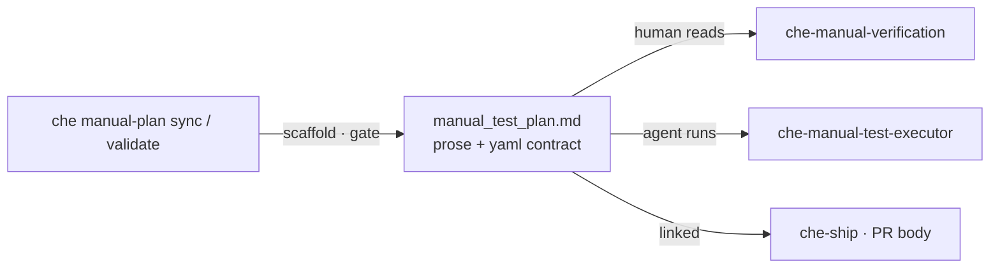

# Che — Manual Test Plan (executable contract)

One artifact, three consumers:



This skill **authors** the plan. It never runs a test and never issues a verdict.

> **SHARED REFERENCES (CANONICAL — DO NOT DUPLICATE body here):**
>
> - Storage boundary and canonical paths: `contracts/path-canonicity-che.md`
> - Worktree session binding (§19) and chat budget (§18): `engineering-contracts` skill
> - Plan file shape (sections, AC headings, severity): `che-act` `references/MANUAL_TEST_PLAN_TEMPLATE.md`
> - Deterministic parser, MP-checks and scaffolding: `che manual-plan` (this skill calls it, never re-implements it)

## 🆚 Boundary vs the neighbours

| Concern | **`che-manual-plan`** | `che-manual-test-executor` | `che-manual-verification` | `che-qa` |
| --- | --- | --- | --- | --- |
| Produces | The plan + contracts | Pass/fail report + evidence | A guide for a layperson | Command results |
| Executes | No | Yes (CDP + terminal) | No | Yes (build/lint/test) |
| Gate | `che manual-plan validate` | Requires that gate to be green | Reads the same contract | CI commands |

## 0. Preflight

```bash
command -v che >/dev/null 2>&1 || { echo "❌ FATAL: 'che' CLI not found on PATH. Zero writes allowed. exit 98"; exit 98; }
SESSION_ID="${CHE_SESSION_ID:-${HARNESS_SESSION_ID:-fallback-manual-plan-session}}"
eval "$(che compute_paths "$WORKTREE_ROOT" "$SESSION_ID" --cwd "$PWD")"
che ensure_dirs "$WORKTREE_ROOT" "$SESSION_ID" --cwd "$PWD"
```

- `WORKTREE_ROOT` confirmed (ask when missing — never infer from the current directory).
- Input source, first match wins: an existing plan (update it) · an Approved SPEC · a ticket · the diff of the increment.

## 1. Collect the acceptance criteria (never invent one)

| Source | What to take |
| --- | --- |
| Existing plan | Every `### AC-<N>:` heading and its prose — the plan is the source of truth once it exists |
| SPEC §4.2 / §4.3 | `B-`/`AB-` rows: Given / When / Then |
| Ticket | Acceptance criteria in the tracker's own words |
| Diff | Only to *confirm* a behaviour exists — never to invent one |

If no acceptance criterion can be found, stop and ask. A plan with invented ACs is worse than no plan.

## 2. Scaffold or migrate — deterministic, always first

```bash
che manual-plan sync "$WORKTREE_ROOT" --slug "<feature-slug>"
```

- Prints `CREATED` / `UPDATED` / `UNCHANGED` and the absolute path — **use that path for everything else**.
- Inserts a TODO skeleton after any AC heading that has no contract. It never rewrites prose and never
  fills content.
- `--path <file>` targets a specific plan; `--dry-run` reports without writing.
- A legacy plan needs no manual migration: one `sync` adds the skeletons in place.

## 3. Fill each contract (this is the only creative step)

Replace every `TODO`. Vocabulary — anything outside it is rejected by the gate:

| Field | Allowed | Notes |
| --- | --- | --- |
| `driver` | `ui` · `api` · `db` · `manual` | One driver per AC. `manual` means every step is `action: manual`. |
| `lane` | `local` · `preview` · `remote` | The cheapest environment that can observe the result. |
| `severity` | `BLOCKER` · `HIGH` · `MEDIUM` · `LOW` | What happens if this AC fails. |
| `evidence` | `screenshot` · `video` · `console_log` · `network_log` · `api_response` · `log_file` | Ask for `video` only on flows of three or more steps. |
| `action` | `goto` · `click` · `fill` · `press` · `wait` · `assert` · `api` · `manual` | |
| locator | `role` + `name`, or `label`, or `text` | **Accessibility-first. `css`, `selector` and `xpath` are rejected on purpose.** |

Rules that keep the contract executable:

1. **One action per step.** Two clicks in one step cannot be reported separately when the second fails.
2. **Assertions are literal.** `expect_visible: Refunded` — never `works`, `correctly`, `as expected` (rejected).
3. **No invented URL, port or path.** Take them from the repository (`README`, scripts, compose, `.env.example`); if unknown, write `TODO` and list it as an open question — the gate will hold.
4. **API steps are self-contained**: `method`, `path`, `expect_status`; add `body` when the endpoint needs one.
5. **`manual` steps carry an `instruction`** a person can follow without context.
6. **Never a secret in the plan.** Environment variables by name; public test cards only.

Canonical block (all of it lives inside the AC section, after the prose):

```yaml
# --- executable contract (AC-2) ---
id: AC-2
driver: ui
lane: local
base_url: http://localhost:3000
evidence: [screenshot, console_log]
severity: HIGH
steps:
  - action: goto
    url: /bookings/B-1001
    expect_visible: Paid
  - action: click
    role: button
    name: Process refund
  - action: fill
    label: Amount
    value: "10.00"
  - action: assert
    expect_visible: Refunded
    expect_api: GET /api/bookings/B-1001 200
```

Write the file with `che write_file_atomic "$PLAN_PATH"` (stdin), never with a direct editor write —
the helper refuses a target inside the worktree.

## 4. The gate (mandatory, and it is not a formality)

```bash
che manual-plan validate "$PLAN_PATH"
```

- Exit 0 → the plan is executable. Print the path and stop.
- Exit 1 → read the failing `MP-` lines, fix exactly those, re-run. **Maximum two rounds.** After
  that, stop and show the remaining failures to the user with the decision: fix now, or ship with the
  AC marked `manual` and no automation.
- Never weaken a check to make it pass: changing `driver: ui` to `driver: manual` to silence the gate
  is a lie the executor will believe.

## 5. Report

Chat delivery (§18 — four sections, in the chat language):

1. 📍 **Status** — created / updated / unchanged, how many ACs, and the plan path.
2. 🧩 **Coverage** — one line per driver (`ui` 3 · `api` 2 · `manual` 1), so the reader sees how much
   is actually automatable.
3. ⚠️ **What a human must still do** — the `manual` ACs and any `TODO` that could not be resolved.
4. 🔗 **Next** — `che-manual-test-executor` to run it, or `che-manual-verification` to hand it to a
   non-technical tester.

Never paste the whole plan into the chat.
