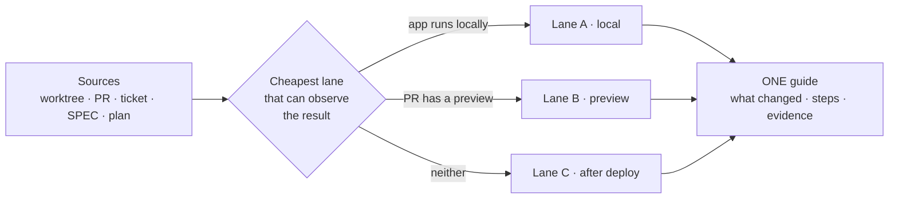

# Che — Manual Verification (plain-language guide a human can execute)

This skill answers exactly three questions, and nothing else:

1. **What does this increment do?** — implemented, changed or fixed, in words a non-technical reader understands.
2. **How do I prove it by hand?** — environment, servers, requests, the exact expected result at each step, and which evidence to capture.
3. **What if I cannot test it here?** — the route to a deployed environment, the access needed to get there, and how to verify safely once there.

It writes **one Markdown artifact**. It never runs the steps, never opens a browser, never issues a verdict.

> **SHARED REFERENCES (CANONICAL — DO NOT DUPLICATE body here):**
>
> - Storage boundary and path canonicity (nothing lands inside the worktree): `contracts/path-canonicity-che.md`
> - Worktree session binding (§19) and chat verbosity budget (§18): `engineering-contracts` skill
> - Manual test plan format (AC / GIVEN-WHEN-THEN / Manual Steps / Severity): `che-act` `references/MANUAL_TEST_PLAN_TEMPLATE.md`
> - Stack-specific install / dev / seed commands: `_shared_checklists/NX_PNPM_COMMON.md` plus the repository's own scripts
> - Secret and PII patterns: `che-compliance` skill

## 🆚 Boundary vs the neighbours (routing — apply before anything else)

| Concern | `che-explain` | `che-qa` | `che-manual-test-executor` | **`che-manual-verification` (this skill)** |
| --- | --- | --- | --- | --- |
| Goal | Understand the change | Run automated gates | Execute a written plan in a real browser | **A human, unaided, can verify** |
| Output | Explanation + Mermaid | Command results | Pass/fail report + PNG evidence | **Numbered guide + evidence checklist** |
| Executes anything | No | Yes | Yes | **No** |
| Reader | Anyone | Engineer | QA / agent | **PM, support, client, new joiner** |
| Verdict | Never | Gate | Per AC | **Never — it reports BLOCKED, not approval** |

- "run the tests" → `che-qa`
- "run the manual plan in the browser" → `che-manual-test-executor`
- "explain this PR / what is this" → `che-explain`
- "write the steps so I — or the client — can check this by hand" → **THIS skill**



## 0. Preflight (mandatory — before any write)

```bash
command -v che >/dev/null 2>&1 || { echo "❌ FATAL: 'che' CLI not found on PATH. Zero writes allowed. exit 98"; exit 98; }
SESSION_ID="${CHE_SESSION_ID:-${HARNESS_SESSION_ID:-fallback-manual-verification-session}}"
eval "$(che compute_paths "$WORKTREE_ROOT" "$SESSION_ID" --cwd "$PWD")"
che ensure_dirs "$WORKTREE_ROOT" "$SESSION_ID" --cwd "$PWD"
che assert_outside_worktree "$CHE_WORKSPACE_SHARED" "$WORKTREE_ROOT" --label "CHE_WORKSPACE_SHARED (durable verification guide)"
GUIDE_PATH="$(che output_path "verification" "che-manual-verification" "<related_id>" "workspace" "md")"
```

- `<related_id>` = ticket key (`FLO-745`) when known, else `pr-<N>`, else `worktree-<slug>`.
- The guide is **workspace-scoped (durable)** because a different person runs it, possibly days later. Evidence captured by that person stays wherever they put it — never inside the repository.
- No bound worktree (PR-only mode) → **ask** for the checkout path. Use the Che-home fallback only if the user explicitly says there is none.

## 1. Collect the context once (fixed order, no guessing)

| # | Source | How to read it | Required | Feeds |
| --- | --- | --- | --- | --- |
| 1 | Worktree / branch | `git -C <wt> status --short`, `git -C <wt> log --oneline <base>..HEAD`, `git -C <wt> diff --stat <base>..HEAD`, then the diff itself | One of 1–3 | What actually changed |
| 2 | PR | `gh pr view <url> --json number,title,body,baseRefName,headRefName,changedFiles,labels,reviewDecision`, `gh pr diff <url> --name-only`, `gh pr checks <url>` | Optional | Preview URL, CI state, linked ticket, review state |
| 3 | Ticket | Linear / ClickUp / GitHub issue through the matching MCP tool | Optional | Intended behaviour and acceptance criteria |
| 4 | SPEC | Latest `$CHE_WORKSPACE_SHARED/specs/**/*.md`; fall back to `$CHE_WORKSPACE_SHARED/spec_*.md` | Optional | Behaviours, explicit non-goals, contracts touched |
| 5 | `manual_test_plan.md` | Path printed by `che manual-plan sync "$WORKTREE_ROOT"` | Optional | Setup commands, AC list and the **executable contract** (driver · lane · evidence) — reuse, never rewrite |
| 6 | Evidence already produced | `$CHE_WORKSPACE_SHARED/qa/`, `$CHE_SESSION_DIR/qa/` reports and manifests | Optional | What automation already proves, so the human does not repeat it |
| 7 | Repo conventions | `README`, `package.json` scripts, compose files, `.env.example`, CI workflow | Required | Exact setup commands, ports, seed targets |

Rules for this step:

- **Base branch**: `gh repo view --json defaultBranchRef`; when two candidates are equally plausible → **ask**, never pick silently. Honour an explicit `--base`.
- **Read the diff, not just filenames.** §1.5 (regression hotspots) cannot be written from a file list.
- **Never invent** a command, URL, port, environment-variable name or role. Every command in the guide must be traceable to a source; add a one-line footnote saying where it came from. Missing → write `unknown — ask <role>` and list it in §9.
- **Existing `manual_test_plan.md` wins on AC wording and setup commands.** This skill adds what the plan does not carry: the plain-language "what changed", the lane decision, the remote path, and the evidence matrix. Map AC-IDs one-to-one.

## 2. Choose the verification lane

| Lane | Use when | Can prove | Cannot prove |
| --- | --- | --- | --- |
| **A · Local** | The app and its dependencies can be installed and started on the tester's machine | Full behaviour, edge cases, logs, database state | Platform routing, real integrations, TLS/domain, production config |
| **B · PR preview** | The PR has a preview deployment — look for it in `gh pr checks` and in PR comments (Vercel, Railway, Netlify, Render, Fly, Cloudflare) | Integrated behaviour on a realistic build | Local-only data, background jobs, third parties still pointing elsewhere |
| **C · After deploy** | Neither A nor B is possible: private network, mobile store build, third-party approval, production-only data | The real thing, end to end | Destructive tests, unreleased data |

Decision rule: **pick the cheapest lane that can actually observe the expected result.** When the increment touches a third party (email, SMS, webhook, payment), name the sandbox or inbox that makes it observable and prefer the lane where that sandbox exists.

**The contract wins.** When an AC carries an executable contract (`driver` · `lane` · `evidence`), that
is the lane and the evidence list — render it, do not re-decide it. This table is for ACs without a
contract, and for explaining *why* the other lanes were discarded. A `manual` driver means the guide is
the only way to verify it; say so instead of implying an agent will.

The artifact always contains §3 of the template below — even when only one lane applies — so the reader knows why the others were discarded.

## 3. Write the artifact — nine sections, in this order

Language: the **docs language** configured for the session (English by default). Chat delivery follows the **chat language**.

### Header — five lines (`engineering-contracts` §23)

| Field | Content |
| --- | --- |
| What this is | One sentence, no jargon |
| Why it matters | One sentence — what the user loses if this is not verified |
| I need from you | Who runs it, and the number of steps per lane |
| Read next | One link, or `nothing — informational` |
| Confidence | `high / medium / low` + one clause (e.g. "medium — no PR preview, lane C path unconfirmed") |

### §1 What this increment does

1. **In one sentence** — no jargon; if a term is unavoidable, define it in the same sentence.
2. **Before → After** table: `Where the user is | Before | After`.
3. **Behaviour table** — one row per user-visible behaviour:

   | # | Behaviour | Type | Who notices | Source |
   | --- | --- | --- | --- | --- |
   | 1 | … | new / changed / fixed | role or persona | ticket AC / behaviour ID / commit |

4. **Not changed on purpose** — the explicit non-goals, so the tester does not test the wrong thing.
5. **Could break nearby** — at most 5 regression hotspots derived from the diff's blast radius. Each: what to look at, and the symptom if it broke.

### §2 What you need before starting

| Item | Why | How to get it | Notes |
| --- | --- | --- | --- |

Cover: accounts and roles (**never passwords**), test data or seed, tools, browser, environment-variable **names only**, feature-flag state, VPN / SSO.

### §3 Which lane applies

The §2 table, the chosen lane, one line of justification, and what the chosen lane cannot prove.

### §4 Lane A — verify locally *(omit only when §3 selects another lane)*

1. **Prepare** — commands in order; after each, "you should see …". Common failure + the fix, one line each.
2. **Start** — servers in order, ports, the log line that means "ready".
3. **Per behaviour** — numbered steps. **One action per step.** Exact URL, exact button label, exact text to type, the expected visible result, and "it is wrong if you see …". Include the negative case and the edge case the AC names. When the AC has a contract, each contract step becomes exactly one numbered step, and the locator's `name` / `label` is the label the reader must look for on screen.
4. **API-only behaviour** — method, URL, headers, body, expected status and body, and where the token comes from. Render requests in an `http` fence, not `bash`.
5. **Evidence per step** — what to capture, and at which frame.
6. **Stop and clean up** — what was created, how to delete it, how to stop the servers.

### §5 Lane B — verify on the PR preview

- Where the URL is (check name / comment), and how to know it is the **right** build (commit SHA or version shown on the page).
- Access limitations: auth provider, allow-listed users, seeded data, anything read-only.
- **Delta table against §4.3** — do not repeat the whole script: list the base URL, the data differences, and what is unavailable here.
- Cleanup of anything created on the preview.

### §6 Lane C — verify after deploy

This is the section that answers "how do I even get there". It must contain, in this order:

1. **Route to the environment** — who merges, which environment receives it (staging / production), and how the tester learns the deploy finished (health endpoint, version or commit endpoint, release notes, deployment dashboard).
2. **Access request** — the exact ask: which role, which environment, who approves. Written as a copy-paste message when the tester is not an engineer.
3. **Safe test data** — the designated test account or tenant, and the **blast radius of each step** (what it creates, who can see it).
4. **Stop rule** — the condition under which the tester stops immediately and escalates (e.g. "a real customer record appears in step 3").
5. **Verification steps** — reference §4.3 with an environment delta (URL, credentials source, data), not a second full script.
6. **Rollback for the tester** — how to undo what the verification created.
7. **If access cannot be granted** — the fallback: verify in staging with a seeded dataset, or hand the check to the named role, and say what remains unproven.

### §7 Evidence checklist

| Behaviour | Lane | Evidence | Where to save | Captured by | Result | Notes |
| --- | --- | --- | --- | --- | --- | --- |

- Naming: `VER-<behaviour#>-<step#>-<yyyyMMdd-HHmm>.png` (or `.log`, `.mp4`).
- A good screenshot shows the **whole window** with the URL and the timestamp visible; a cropped button proves nothing.
- Record a short video (≤60 s) only for flows of three or more steps, or for anything animated.
- `Result` accepts exactly `PASS`, `FAIL`, `BLOCKED` — `BLOCKED` means "could not reach the condition", not "looks fine".

### §8 If something fails — report exactly this

A fill-in template: UTC timestamp, environment and URL, account role, numbered steps taken, expected vs actual, screenshot, browser console or network entry, correlation or request id, and where to send it.

### §9 Not verifiable by hand, and open questions

- Items a human cannot prove (performance, security internals, migrations, load) and **who** verifies them instead (CI, `che-compliance`, load test).
- Every `unknown — ask <role>` collected in §1.

## 4. Quality bar (hard rules)

1. **Plain language.** No jargon without an inline definition. "Endpoint" → "the address the page calls".
2. **One action per numbered step.** Never two clicks in one step.
3. **Every step has an observable expected result.** If nothing is observable, it is not a step — move it to §9.
4. **Copy-paste ready.** Commands and URLs in fenced blocks; API requests in `http` fences.
5. **No secrets.** Environment-variable names only; only public test cards (`4242 4242 4242 4242`).
6. **Never destructive in a shared environment.** If the check requires deleting or overwriting, use a test tenant and state the approval line explicitly.
7. **Never execute.** No browser automation, no running the setup, no "I tested it for you". That is `che-manual-test-executor`.
8. **State the effort.** Steps per lane, so the reader can plan.
9. **Uncertainty is explicit.** `unknown — ask <role>` beats a confident wrong step.
10. **No verdict.** The guide reports PASS / FAIL / BLOCKED for a human to fill in; it never says "approved" or "ready to merge".

## 5. Save and deliver

```bash
# GUIDE_PATH was resolved in §0; re-run §0 if the variable is empty.
printf '%s' "$GUIDE_PATH"
```

Example result: `$CHE_WORKSPACE_SHARED/verification/FLO-745/20261113-104500-che-manual-verification.md`

**Chat delivery** (`engineering-contracts` §18 — four sections, ≤400 words, in the chat language):

1. 📍 **Status** — what was analysed (sources actually found), the chosen lane, and the guide path.
2. 🧩 **What changed** — at most three plain-language bullets, one per user-visible behaviour.
3. 🧪 **First three steps** — enough for the reader to start right now, with the expected result of each.
4. 🔗 **Refs + one offer** — guide path, PR or ticket link, and a single question ("quer que eu detalhe o caminho de deploy ou gere a versão para o cliente?").

Never paste the whole guide into the chat.
